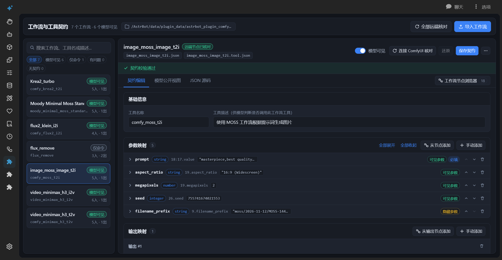

# AstrBot ComfyUI 工作流适配器 (`astrbot_plugin_comfy_runner`)

外部 ComfyUI 的 AstrBot 工作流适配器。将用户在 ComfyUI 中导出的 API 格式工作流（`.json`）与显式工具契约（`.tool.json`）配对，同时支持 **AI 模型工具调用** 与 **不经过模型的手动命令逐轮填参执行**，并提供内置 WebUI 管理页面用于可视化配置与实时核对。



## 核心特性

- **双调用入口（模型工具 + 无模型命令向导）**
  - **模型工具**：固定公开 `comfy_list`、`comfy_inspect`、`comfy_execute`、`comfy_task` 四个工具，仅对标记 `model_visible: true` 的工作流可见；不向系统提示词注入额外规则，也不修改节点图结构。
  - **手动命令**：通过 `/comfy run` 在本地管线拦截用户后续消息（`SessionWaiter`，按会话来源与发送者隔离），逐轮引导填写参数并直接提交执行，全过程不经过大模型；所有配好契约的工作流（含 `model_visible: false`）均可通过命令调用。
- **显式工具契约（`.tool.json`）**
  - 每个工作流对应同名契约文件，显式声明名称、说明、`model_visible`、输入参数映射（类型、约束、可见性 `visible`、必填性 `required`）与正式产物输出映射。
  - 隐藏字符串参数（`visible: false` + `type: "string"`）支持 `value_template` 时间模板（如 `out/%date:yyyy-MM-dd%/img-%date:HHmmss%`），每次提交按容器本地时间展开。
  - 每次执行读取原始工作流副本，只覆盖本次显式提供的参数，未提供或未映射字段（如 `seed`）保持工作流原值。
- **多模态输入与逐条产物交付**
  - 支持 `image` / `video` / `audio` / `file` 四类引用参数：命令模式可直接发送或回复附件、粘贴 `http(s)` 链接（禁止本地路径）；模型工具额外支持 `attachment[:N]`、`task:<任务ID>[:N]`、本地绝对路径与 `file://` URI。
  - 同步校验并提交到 ComfyUI 拿到 `prompt_id` 后立即结束工具/向导并释放会话锁，任务状态与产物位置持久化写入 `tasks.db`；按 `deliver` 参数后台发送并在发送后清理 `temp/` 临时文件，也可通过 `comfy_task` 查询、等待、按需下载、补发或取消任务。
- **WebUI 可视化管理与热刷新**
  - 在 AstrBot 后台「工作流与映射规则」视图中导入 `.json` 工作流、浏览节点与字段、连接 ComfyUI `/object_info` 远端核对类型、编辑契约并保存热刷新（无需重启容器）。
- **多平台访问控制与并发边界**
  - 按 `平台:ID` 隔离的管理员、白名单（支持群聊、私聊与 Telegram 话题群 `<chat_id>#<thread_id>`）、全局锁定、用户冷却、分群/私聊敏感词策略（`none` / `lite` / `full`）与有界并发上限。

## 快速开始

### 1. 配置插件

在 AstrBot 插件配置中检查以下基础项：

- `server_address`：ComfyUI 服务地址（默认 `127.0.0.1:8188`）。
- `control.admin_ids`：管理员 ID（建议带平台前缀，如 `telegram:123456`、`aiocqhttp:123456`，也兼容纯数字 ID）。
- `control.whitelist_ids`：允许使用工作流的群或用户（如 `telegram:group:-100123`、`aiocqhttp:user:123456` 或简写 ID）。

### 2. 导入工作流并配置契约

1. 在 ComfyUI 界面开启开发者模式后，使用 **Save (API Format)** 导出工作流 `.json`。
2. 打开 AstrBot WebUI 中本插件的 **「工作流与工具契约」** 管理页，拖入或点击「导入工作流」上传 `.json`，挑选需要公开的节点字段与输出节点，填写工具名、说明与参数约束并保存。
   - 也可以直接把配对好的 `<name>.json` 与 `<name>.tool.json` 放入插件数据目录 `data/plugin_data/astrbot_plugin_comfy_runner/workflow/`，随后发送 `/comfy reload` 热刷新。

### 3. 开始使用

- **让模型调用**：确保契约开启「模型可见」（`model_visible: true`），在聊天中直接提出需求，模型会自行调用 `comfy_list` / `comfy_inspect` / `comfy_execute` / `comfy_task`。
- **手动命令调用（不经过模型）**：
  1. 发送 `/comfy ls` 查看编号清单，或直接发送 `/comfy run`；
  2. 发送 `/comfy run <序号或工作流名>`（如 `/comfy run 1`）启动向导；
  3. 按提示每轮输入一个参数：
     - 枚举参数（如画幅比例）直接回复选项序号或原值；
     - 文件/图片类参数直接发送或回复对应媒体/文件消息，或粘贴 `http(s)` 链接；
     - 布尔参数支持 `true`/`false`、`是`/`否`、`1`/`0`、`on`/`off`、`开`/`关`；
     - 可选参数回复 `跳过`（`skip`）保留工作流原值；当剩余参数全部为可选时，回复 `立即执行`（`run`）直接提交；
     - 任意一轮回复 `取消` 或 `/comfy cancel` 可中止向导。

## 指令速查

### 普通用户（需在白名单内）

| 指令 | 说明 |
|---|---|
| `/comfy help` | 查看指令帮助与当前会话访问状态 |
| `/comfy ls` | 查看可用工作流编号、名称、模型可见性与说明 |
| `/comfy run [序号或工作流名]` | 手动触发工作流并逐轮收集参数（无参时先列出清单供选择） |
| `/comfy cancel [任务ID]` | 取消当前参数收集向导，或取消指定进行中的任务 |

### 管理员指令

| 指令 | 说明 |
|---|---|
| `/comfy ls` | 查看全部工作流与契约的序号、文件名、可见性与校验问题 |
| `/comfy check [remote]` | 校验全部契约映射；带 `remote` 时额外向 ComfyUI `/object_info` 核对字段与输出节点 |
| `/comfy reload` | 重新读取并校验全部契约并在内存中热刷新（校验失败时保留原状态） |
| `/comfy lock [on\|off\|status]` | 查看或切换全局锁定（开启后仅管理员可用） |
| `/comfy policy [none\|lite\|full]` | 查看或设置当前群聊的敏感词过滤级别（别名 `/comfy banlevel`） |

## 配置说明

完整 Schema 见 [`_conf_schema.json`](_conf_schema.json)：

| 配置项 | 默认值 | 说明 |
|---|---|---|
| `server_address` | `127.0.0.1:8188` | ComfyUI API 地址（`host:port`） |
| `execution.max_concurrency` | `2` | 同时执行的工作流上限，超限直接拒绝不排队 |
| `execution.timeout_seconds` | `300` | 单次执行在后台等待结果的总时长上限（秒） |
| `execution.poll_interval_seconds` | `1.0` | 轮询 ComfyUI `/history` 状态的间隔（秒） |
| `execution.interactive_timeout_seconds` | `120` | 手动命令每一轮等待用户输入的空闲超时（秒，最小 `10`） |
| `control.cooldown_seconds` | `35` | 同一用户两次提交之间的冷却时间（秒） |
| `control.admin_ids` | `[]` | 管理员列表，支持 `平台:ID` 或纯 `ID` |
| `control.whitelist_ids` | `[]` | 白名单，支持 `[平台:]group\|user:ID` 或 `[平台:]ID` |
| `control.default_group_policy` | `lite` | 群聊默认敏感词策略（`none` / `lite` / `full`） |
| `control.default_private_policy` | `lite` | 私聊默认敏感词策略（`none` / `lite` / `full`） |
| `control.lockdown` | `false` | 启动时是否开启全局锁定 |
| `control.lockdown_command_enabled` | `true` | 是否允许管理员通过 `/comfy lock` 动态切换全局锁定 |
| `control.admin_bypass` | 全 `true` | 管理员是否跳过白名单、冷却与敏感词检查 |

## 工具契约与示例

每个工作流由同名的 `<stem>.json`（ComfyUI API Format 导出的节点图）与 `<stem>.tool.json`（工具契约）组成，格式规范见 [`schemas/tool-contract-v1.schema.json`](schemas/tool-contract-v1.schema.json)。

契约顶层包含 `version`（`1`）、`name`、`description`、`model_visible`、`inputs` 与 `outputs`：

- `inputs.<参数名>`：声明 `type`（`string` / `integer` / `number` / `boolean` / `image` / `video` / `audio` / `file`）、`description`、`target: {node, field}`，以及可选的 `visible`、`required`、`enum`、长度/数值上下界，或仅用于隐藏字符串参数的 `value_template`（如 `"moss/%date:yyyy-MM-dd%/img-%date:HHmmss%"`）。
- `outputs.<产物名>`：声明 `type`（`image` / `video` / `audio` / `text` / `file`，决定插件如何下载和以何种消息段交付）与 `target: {node, field}`（指定去 ComfyUI `/history` 返回结果的哪个节点和字段下读取列表，例如部分视频节点输出在 `images` 字段中）。

仓库 [`examples/`](examples) 目录提供了 4 份参考契约：

- [`examples/image_moss_image_t2i.tool.json`](examples/image_moss_image_t2i.tool.json)：MOSS 文生图（含枚举与数值范围）
- [`examples/Krea2_turbo.tool.json`](examples/Krea2_turbo.tool.json)：Krea2 Turbo 写实文生图
- [`examples/flux2_klein_i2i.tool.json`](examples/flux2_klein_i2i.tool.json)：Flux2 Klein 图生图（含 `image` 引用参数）
- [`examples/video_minimax_h3_t2v.tool.json`](examples/video_minimax_h3_t2v.tool.json)：MiniMax H3 文生视频（演示 `type: "video"` 从 `images` 字段提取）

## 开发与文档

- 架构与开发规范：[`AGENTS.md`](AGENTS.md)
- 领域术语表：[`GLOSSARY.md`](GLOSSARY.md)
- 架构决策记录：[`docs/adr/`](docs/adr)
- 变更记录：[`CHANGELOG.md`](CHANGELOG.md)
- 全量检查（`ruff` + 注释检查 + 装饰字符检查 + `pytest`）：

```bash
./scripts/check.sh
```
